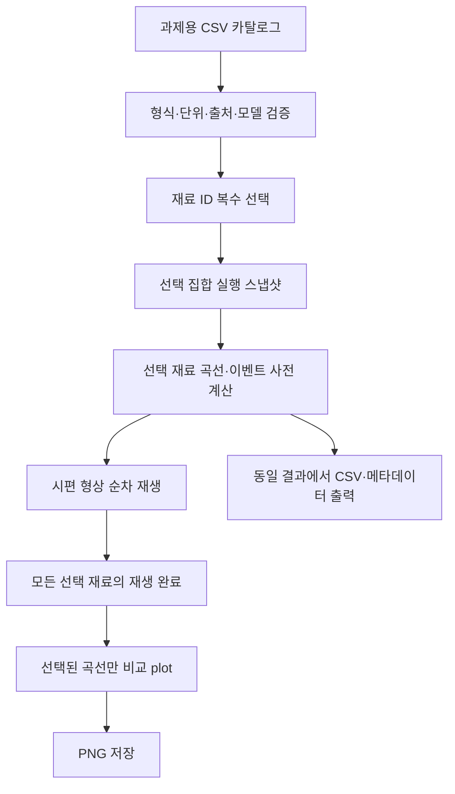
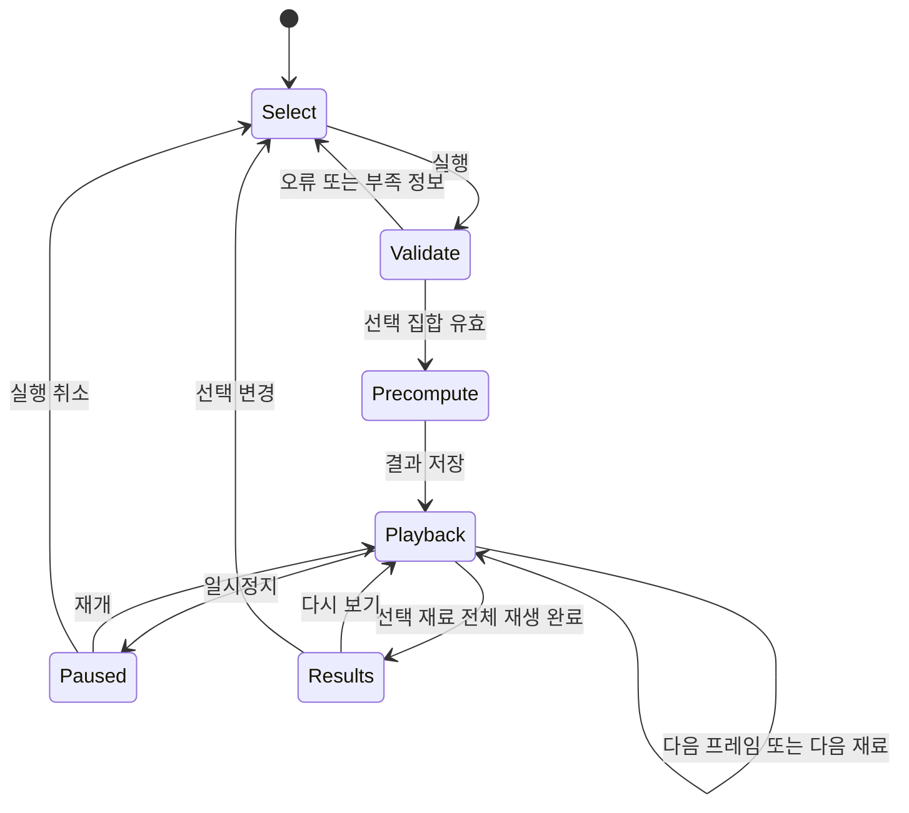

# Universal Tensile Test & Stress–Strain Simulator 개발 계획

- 작성일: 2026-10-18, Asia/Seoul
- 상태: 아래 본문은 구현 전 설계 기록이다. 2026-10-18 영어 프로그램과 강의표 기반 CSV 구현을 완료했으며, 최종 구현은 [README.md](README.md), 출처는 [SOURCES.md](SOURCES.md)를 참조한다.
- 구현 후 확인: 사용자 제공 이론 PDF 8쪽 물성표에서 실제 재료·상태 8개를 확인했다. Q3 가상 Al을 더해 총 9개이며, 황동의 Annealed/Cold-rolled 상태를 별도 데이터셋으로 구분한다. 본문 중 물성 미확인·8개 예상 등의 내용은 당시의 계획 기록이며 이 확인 결과로 대체한다.
- 모델 변경: 초기 탄성계수와 0.2% 내력을 동시에 만족시키는 역함수 기반 전반부와 검증된 Hermite 후반부를 사용한다. 접합점의 C1 연속성을 일반적으로 보장하지 않으며, 자세한 수식·가정·검증은 README를 따른다. 실측 곡선 정확도를 검증했다는 뜻은 아니다.
- 최우선 원칙: 입력 오류 예방 → 수학·물리적 일관성 → 과제 충족 → 구조 단순화 → 성능·유지보수 → 시각적 완성도. **출처: 사용자 최초 요구 [U1].**

## 출처 표기와 확인 범위

본문의 **[요구사항]**은 사용자 지시, **[문헌 근거]**는 실제 확인한 외부 자료, **[설계 제안]**은 그 요구와 근거에 따라 이 계획에서 선택한 구현 방침, **[자체 유도]**는 제시한 가정에서 직접 계산한 결론이다. 외부 문서가 이 프로젝트의 설계 전체를 권고한 것처럼 인용하지 않는다. 절이나 표 앞의 출처 표기는 해당 절·표에 적용하며, 별도 근거가 필요한 주장에는 추가 출처를 단다.

| 분류 | 확인한 자료와 범위 | 이 계획에서의 사용 |
|---|---|---|
| 사용자 최초 요청 | 첨부 텍스트의 전체 요구사항 [U1] | Q2–Q4 대상, 우선순위, 모델·검증·복잡도 요구 |
| 사용자 후속 요청 | 아래에 기록한 대화 발언 [U2] | CSV 카탈로그 선택 방식, 데이터셋 구분, 형상 재생 선행 |
| 로컬 실험 매뉴얼 | 연세대학교, 2023-2 기계공학실험(1), 4쪽 전체의 텍스트·화면 확인 [L1] | 시험 목적·절차 확인만 가능 |
| 역학 근거 | MIT 강의자료, NASA 원 보고서 소개, Instron 기술자료 [M1]–[M5] | 응력·변형률 정의, 모델 적용 조건과 한계 |
| 소프트웨어 근거 | Python·NumPy·SciPy·Streamlit·Plotly·Pytest 공식 문서 [S1]–[S14] | API 기능과 구현 가능성 확인 |

**[로컬 자료 확인]** [L1]은 1쪽 표지, 2쪽 목적, 3쪽 실험 절차, 4쪽 안전 지침으로 구성된다. 확인한 파일에는 prelab 2·3·4 문항 및 대상 재료의 물성표가 없다. 따라서 재료 목록과 배율은 [U1]에서 가져왔으며, 실제 과제지와 물성값은 별도 확인이 필요하다. 이 매뉴얼을 Al·Brass·PC·Cast Iron·PS·Monel의 수치 물성 출처로 사용하지 않는다.

**[출처 관리 방침]** 웹 자료의 확인일은 2026-10-18이다. 라이브러리 문서는 갱신될 수 있으므로 구현 때 사용 버전을 고정한다. 확인하지 않은 교재 판·쪽, GitHub 커밋, 강의자료의 물성 수치를 만들지 않는다. 문서에서 인용한 다른 교재를 직접 읽은 출처로 재인용하지 않는다. **출처: 사용자 출처 명시 요청 [U2]에 따른 설계 제안.**

## A. Requirements Analysis

### A.1. 최종 제품 정의와 이전 계획의 변경

**[요구사항: U1·U2]** 개발자가 prelab 2·3·4에 필요한 물성 데이터셋을 CSV로 준비하고, 사용자는 원하는 재료를 복수 선택한다. 선택한 재료의 시편 거동을 먼저 보여준 뒤, 선택된 재료만 하나의 Engineering Stress–Strain 그래프에 표시한다.

| 항목 | 최종 계획 | 근거 |
|---|---|---|
| 일반 사용자 입력 | 검토된 CSV 카탈로그에서 선택 | 최신 요구 [U2] |
| 물성 직접 입력 | 일반 사용 흐름에서 제외, 데이터 작성·검수 작업으로 이동 | [U2]에 따른 설계 제안 |
| 재료 구분 | 같은 이름이라도 물성·상태·정의·시험 조건이 다른 데이터셋은 별도 ID | [U2]에 따른 식별 규칙 |
| 실행 대상 | 선택된 ID 집합만 계산·재생·plot·export | [U2] |
| 표시 순서 | 형상 거동 재생 → 비교 plot | [U2] |
| 내부 계산 순서 | 검증 → 선택 데이터 사전 계산 → 형상 재생 → plot 공개 | 표현 일관성을 위한 설계 제안 [U1]·[U2] |
| 자동 재생 | MVP에 포함 | 형상 거동을 먼저 시행하라는 [U2]의 구현 해석 |
| 출력 | PNG, 계산 CSV, 사용 물성·가정·출처 메타데이터 | [U1] 및 추적성을 위한 설계 제안 |

**[설계 제안]** 최초 요청의 “재료 데이터베이스를 내장하지 않는다”는 항목은 최신 지시에 맞춰 수정한다. 프로그램 코드에 물성을 하드코딩하지 않고, 별도로 검토·교체 가능한 과제용 CSV 카탈로그를 함께 제공한다. 범용 계산 코어와 과제 데이터는 분리한다. 변경 근거는 [U2]이며, 이는 데이터베이스 서버를 도입한다는 의미가 아니다.

### A.2. 재료는 기본 8개, 조건에 따라 9개

**[자체 유도: U1의 과제 구성 + U2의 구분 기준]** 과제에 등장하는 항목 수는 5 + 2 + 2 = 9이다. Q2와 Q3의 기본 Al 2024-T4가 같은 물성·정의·상태·조건을 사용하면 한 데이터셋을 공유하여 고유 데이터셋은 8개다. 서로 다른 입력을 사용한다면 별도 등록하여 9개가 된다. 이 개수는 재료학 문헌의 사실이 아니라 과제 데이터의 중복 제거 결과다.

| 제안 ID | 표시할 데이터셋 | 과제 | 확인 상태 |
|---|---|---|---|
| `al2024_t4_reference` | Aluminum 2024-T4, 기준 | Q2·Q3 | 실제 물성표 미확인 |
| `yellow_brass_reference` | Yellow Brass | Q2 | 상태·물성 미확인 |
| `polycarbonate_reference` | Polycarbonate | Q2 | 시험 조건·물성 미확인 |
| `gray_cast_iron_reference` | Gray Cast Iron | Q2 | 등급·물성 미확인 |
| `polystyrene_reference` | Polystyrene | Q2 | 시험 조건·물성 미확인 |
| `al2024_t4_virtual` | 가상 Al: E × 1.5, 항복강도 × 1.3 | Q3 | 기준 데이터에서 파생 예정 |
| `monel400_annealed` | Monel Alloy 400, Annealed | Q4 | 실제 물성표 미확인 |
| `monel400_cold_worked` | Monel Alloy 400, Cold-worked | Q4 | 가공 조건·물성 미확인 |

**[설계 제안]** 위 ID는 계획서에서 제안한 식별자이며 기존 파일에 존재하는 값이 아니다. Q2·Q3의 기준 Al이 다르면 `al2024_t4_q2`와 `al2024_t4_q3_reference`로 분리하고 가상 Al의 부모는 Q3 기준으로 지정한다. 같은 재료가 여러 과제에 포함된다는 이유만으로 행을 복제하지 않는다. 반대로 이름이나 몇 개 숫자가 우연히 같다는 이유로 자동 병합하지 않는다. **근거: U1·U2.**

### A.3. 범위와 완료 조건

**[요구사항·설계 제안: U1·U2]** 범위는 정해진 시험 조건에서의 단조 일축 인장 곡선 재구성 및 교육용 시각화다. 하중 이력, 피로, 다축 소성, 균열 전파, FEM, 온도·속도 의존성 예측은 MVP에서 제외한다. 조건을 기록하는 것과 그 영향을 예측하는 기능은 구분한다.

- Q2: 다섯 대상의 형상 재생 후 다섯 곡선을 같은 축에 표시한다.
- Q3: 기준과 가상 Al만 선택하여 두 곡선을 비교한다. 배율 외 물성의 유지·변경 정책을 표시한다.
- Q4: Monel의 두 상태를 별도로 계산하고 비교한다.
- 임의 선택: 고른 ID만 실행하며 선택하지 않은 재료의 곡선·범례·출력 행을 넣지 않는다.
- 데이터 부족: 전체 곡선이 정의되지 않은 자료를 “실행 준비 완료”로 표시하지 않는다. 부족한 필드를 보여준다.
- 과제 전체 완료 판정은 실제 물성 출처와 모델 가정을 채운 뒤 수행한다. 재료명 목록만 준비되었다고 과제가 완료된 것은 아니다.

## B. Recommended Architecture

### B.1. 단일 애플리케이션과 계산 코어

**[설계 제안: U1의 단순성·책임 분리, U2의 실행 순서]** 별도 DB·API 서버·작업 큐 없이 로컬 Streamlit 앱을 만든다. 계산은 UI와 독립된 순수 함수로 작성하고, 재료명에 따른 if문 대신 `model_id`와 검증된 파라미터로 평가한다.

**[설계 제안]** 일반 사용자 화면에서 입력표 편집보다 선택 UI를 우선한다. 데이터 관리용 편집 기능은 후속으로 둘 수 있다. 실행 스냅샷에 선택 ID·카탈로그 내용 해시·모델 버전·샘플링 설정을 저장하여, 재생 도중 자료가 바뀌어도 한 실행에서 혼합되지 않게 한다. 근거는 일관성과 결정성 요구 [U1]·[U2]이며 해시 구조 자체는 본 계획의 선택이다.

### B.2. 기술 선택

| 기술 | 결정·용도 | 근거와 한계 |
|---|---|---|
| Python 표준 `csv`, `json`, 자료구조 | CSV·메타데이터와 작은 데이터 객체 | CSV 파서는 의미 검증까지 수행하지 않음 [S1] |
| NumPy | 응력·변형률 배열 계산 | 벡터화에 유용하나 불필요한 큰 배열은 피함 [S2] |
| SciPy | Hermite/PCHIP·필요한 근 탐색 | 재료 법칙이나 제약을 자동 검증하지 않음 [S3]·[S4] |
| Streamlit | 선택·재생 상태·결과 UI | multiselect, Session State, fragment 사용 [S5]·[S6]·[S7] |
| SVG | 파라메트릭 2D 시편 | `st.image`가 SVG 문자열을 지원 [S8] |
| Plotly | 최종 다중 곡선·확대·PNG | Streamlit 연동 및 브라우저 저장 [S9]·[S10] |
| Pytest | 반복 가능한 검증 | 파라미터화 테스트 지원 [S12] |
| Kaleido | MVP 제외 | 서버 이미지 생성이 필요할 때 추가. 현재 방식은 브라우저 PNG [S10]·[S11] |
| FEM·별도 프런트엔드·DB | MVP 제외 | 현재 요구 대비 복잡성이 크다는 설계 판단 [U1]·[U2] |

**[설계 제안]** 독립된 재료 클래스 상속 계층을 만들지 않는다. 데이터 클래스 + 공통 함수 계약을 채택한다. pandas를 별도 계산 엔진으로 도입하지 않아도 되며, Streamlit의 전이 의존성까지 “없다”고 주장하지 않는다. 실제 의존성 버전은 설치·통합검증 후 고정한다. **근거: U1의 KISS·YAGNI·유지보수 요구.**

## C. Mathematical Modeling Strategy

### C.1. 물리량 정의

**[문헌 근거]** 기본 출력은 공학적 응력과 공학적 변형률이다. 아래 정의의 근거는 Roylance의 식 (1), 인쇄 p.1이다. [M1]

\[
\sigma_e=F/A_0,\qquad \varepsilon_e=(L-L_0)/L_0
\]

**[자체 유도]** 위 정의에서 시편 표점거리와 힘은 다음과 같다. 실제 치수가 없으면 정규화 길이만 표시하고 N 단위 힘은 산출하지 않는다. 치수 없는 자료의 표시 방침은 본 계획의 제안이다.

\[
L=L_0(1+\varepsilon_e),\qquad F=\sigma_e A_0
\]

**[문헌 근거]** 0.2% 내력은 기울기 E의 오프셋 직선과 곡선의 교점이며, 선형 탄성구간의 끝점과 같은 개념이 아니다. [M1] (p.3)

\[
\sigma_e(\varepsilon_{0.2})=E(\varepsilon_{0.2}-0.002)
\quad\Rightarrow\quad
\varepsilon_{0.2}=\sigma_{0.2}/E+0.002
\]

**[설계 제안]** `yield_definition`에 명확한 항복점·상/하항복·offset·고분자 지정 정의·해당 없음·미확인을 구분하고, offset에는 `offset_strain`을 저장한다. 명확한 항복점도 그 전 구간의 선형성을 채택한 경우에만 \(\varepsilon_y=\sigma_y/E\)로 도출한다. 내력의 실제 교점은 생성 곡선에서 재검증한다. **근거: M1의 정의와 본 계획의 검증 방침.**

**[문헌 근거]** UTS는 최대 공학응력이고, 파단 직전 응력과 항상 같지는 않다. 네킹 이후 공학응력의 하강을 진응력의 재료 연화와 동일시하지 않는다. [M1] (pp.3–4)

**[문헌 근거]** 파단 후 영구 연신율 A와 파단 시 총연신율 At는 탄성 회복 때문에 구별된다. 표점거리와 측정 방식도 확인해야 한다. [M3] (p.1, Metals Tensile Applications)

**[설계 제안]** `elongation_definition`을 저장하고, 정의 불명 연신율은 파단 직전 애니메이션 끝점으로 자동 사용하지 않는다. 균일 소성 연신율과 최대하중에서의 총변형률도 다른 필드 정의로 취급한다. 표점거리 기준을 바꾸거나 파단 후 값을 파단 전 값으로 바꾸는 임의 보정은 하지 않는다. **근거: M3 및 데이터 의미 보존 요구 U1.**

### C.2. 네 물성으로 곡선이 유일하지 않다는 검토

**[자체 유도]** E·항복강도·UTS·파단연신율은 전체 함수의 유한한 제약일 뿐이다. 조건을 만족하는 곡선의 특징점 사이에서만 값이 있는 작은 매끄러운 함수를 더하되, 특징점 값과 원점 접선을 바꾸지 않으면 다른 곡선도 같은 제약을 만족할 수 있다. 제약에 여유가 있는 구간에서는 충분히 작은 변경으로 단조성과 최대값 조건도 유지할 수 있다. 따라서 주어진 값만으로 모든 중간 응력, UTS의 변형률, 파단 직전 응력을 유일하게 결정할 수 없다.

**[설계 제안]** 프로그램은 “실측 곡선의 자동 복원” 대신 “입력 데이터와 명시적 형상 가정에 따른 곡선 재구성”으로 결과를 설명한다. 누락 정보는 강의자료의 곡선·동일 조건 문헌·명시적 가정 순으로 보완하며, 곡선 피팅과 보간을 혼동하지 않는다. **근거: 위 자체 식별 가능성 검토, U1의 임의 추정 금지.**

### C.3. 후보 비교와 최소 모델

**[검토·설계 제안]** 다음 표의 식·수치 도구 근거는 표에 표시하며, 채택 여부는 이 프로젝트의 데이터 제약에 따른 판단이다. 연산 비용은 N개 점을 평가하는 구현에 대한 자체 분석이다.

| 후보 | 필요한 정보·적용 범위 | 비용·한계 | 결정·근거 |
|---|---|---|---|
| Hooke | E, 종료점. \(\sigma=E\varepsilon\) | O(N). 파단까지 선형인지 별도 확인 | 기본 모델 [M1] (p.2) |
| 특징점 기반 구간 모델 | 특징점·정의·접선 정책 | O(N+P). 빠진 특징점을 알아내지 못함 | 기본 모델, 자체 설계 |
| Ramberg–Osgood | E·강도 기준 외 형상 파라미터 | 직접 매개화 O(N), 역산 시 반복 비용. 파단·하강 별도 | 데이터가 있으면 후속 [M4] |
| Hollomon 계열 | 진소성변형률 기준 경화 계수·지수, 탄성·항복 연결 | O(N) 또는 반복 비용. 균일변형 이후 처리 별도 | 후속. 멱경화 후보의 근거 [M1] (pp.6–7); 진소성변형률을 쓰는 세부 변형은 채택 전 별도 문헌 확인 |
| PCHIP | 순서 있는 점 | 형상 보존, 원점 기울기 E 자동 강제 불가 | 보조 도구 [S3] |
| Cubic Hermite | 점과 1차 도함수 | O(N+P), 임의 접선이면 오버슈트 가능 | 제약 검증과 함께 채택 [S4] |
| 별도 고분자 모델 | 온도·속도·거동별 파라미터 | 기본 물성으로 식별 어려움 | 고급 구성식은 후속 [M2]; 현재는 특징점 재구성 |

**[설계 제안]** MVP의 계산 커널은 `linear`와 `anchored_piecewise` 두 개로 제한한다. 재료마다 전용 곡선을 하드코딩하지 않는다. 계수가 알려진 고급 구성식을 추가하는 것이 부족한 물성 문제를 자동 해결하지는 않는다. **근거: U1, C.2 검토.**

#### C.3.1. 선형 모델

**[자체 유도·설계 제안]** 파단까지 선형이라는 명시적 근사를 채택한 경우 E와 파단응력 또는 E와 파단변형률 중 두 독립량으로 나머지를 계산한다. \(\sigma_f=E\varepsilon_f\)와 맞지 않는 세 값을 동시에 강제할 수 없다. 모순이 있으면 데이터를 덮어쓰지 않고 비선형 모델이나 정의 검토가 필요하다고 알린다. “취성”이라는 이름만으로 선형 모델을 자동 선택하지 않는다. **기초 식 근거: M1, p.2.**

#### C.3.2. 제약된 구간 모델

**[설계 제안: S3·S4의 수치 도구를 이용한 자체 구성]** 초기 구간·항복 전이·경화·국부 극값·드로잉·파단 직전 끝점 중 필요한 구간만 정의한다. 각 구간에서 끝점 값과 접선을 지정하는 Hermite 다항식을 사용한다.

\[
\sigma(t)=h_{00}\sigma_i+h_{10}\Delta\varepsilon_i m_i+h_{01}\sigma_{i+1}+h_{11}\Delta\varepsilon_i m_{i+1},
\qquad t=(\varepsilon-\varepsilon_i)/\Delta\varepsilon_i
\]

**[설계 제안]** 접선 정책은 모델 버전에 포함하여 재현 가능하게 한다. 초기 접선은 E, 매끄러운 극점은 0, 나머지는 형상 보존 규칙에서 시작한다. 입력으로 정해진 E·점 좌표를 변경하지 않고 접선 조건과 구간 단조성·최대값·음의 응력을 검사한다. PCHIP 접선을 만든 뒤 E만 바꾸면 형상 보존 보장이 유지된다고 가정하지 않는다. 조건을 만족하지 못하면 구성 실패와 필요한 추가 특징점을 반환한다. **근거: S3·S4의 기능 범위에 대한 설계 판단.**

**[자체 유도]** 3차 구간의 도함수는 2차식이다. 구간 내부의 도함수 근과 끝점을 검사하면 샘플 사이 극값도 확인할 수 있다. 내력 조건 역시 오프셋 선과의 교점·잔차로 검증하고, 여러 교점이 생기면 지정한 정의와 일치하는지 확인한다.

**[설계 제안]** 파단 전에는 C0 연속성을 요구하고, 매끄러운 연결로 지정한 곳은 C1을 요구한다. 명확한 항복 모서리에 C1을 강제하지 않는다. 곡선 종료 이후 외삽하지 않으며, 이 모델을 언로딩·다축 응답까지 정의하는 일반 구성방정식으로 설명하지 않는다. **근거: U1의 수학적 타당성 요구 및 이 모델의 정의.**

### C.4. 데이터셋별 적용과 Q3

**[설계 제안: U1의 대상 목록, M1·M2의 적용 범위]** Al·Brass·Monel은 항복 정의와 경화 자료를 먼저 확인한다. Gray Cast Iron·Polystyrene은 선형 여부를 검토한 취성 종료 또는 비선형 특징점 모델을 사용한다. Polycarbonate는 실제 자료가 보여주는 항복·국부화·드로잉·재경화 특징점을 사용한다. 이는 모델 검토 순서이며, 해당 강종·등급의 실측 거동을 확인했다는 의미가 아니다.

**[문헌 근거]** 고분자에는 서로 다른 거동과 국부화 기구가 있고 crazing은 체적 증가를 수반할 수 있다. 모든 고분자에 금속과 같은 네킹·등체적 가정을 부여하지 않는다. MIT의 일반 고분자 예시를 이번 PC·PS의 실측 자료로 대체하지 않는다. [M2] (PDF pp.1–3, 5–6)

**[요구사항·자체 유도: U1]** 가상 Al은 기준의 E에 1.5, 항복강도에 1.3을 곱한다. 0.2% 내력이라면 변경된 점은 다음과 같다.

\[
E'=1.5E,\quad \sigma_{0.2}'=1.3\sigma_{0.2},\quad
\varepsilon_{0.2}'=\frac{1.3\sigma_{0.2}}{1.5E}+0.002
\]

**[설계 제안]** 원본 곡선 전체를 배율 확대하지 않고 새로운 파라미터로 다시 구성한다. 다른 물성·형상 가정을 유지한다면 그 자체를 Q3의 비교 가정으로 기록한다. 변경된 항복강도가 유지한 UTS보다 커지거나 구간 순서가 깨지면 오류로 처리하고 UTS를 자동 상향하지 않는다. 부모 ID·적용 배율·변경 필드·유지 필드가 출처 기록에 남아야 한다. **근거: U1 및 M1의 UTS·내력 정의.**

### C.5. 민감도와 물성 분석

**[설계 제안: U1]** 모델 준비 단계에서 UTS 발생 변형률·파단응력·전이 형상처럼 가정에 의존한 값을 바꾸어 결과 영향을 확인한다. 범위의 근거를 기록하며 임의의 ±10%를 물리적 불확실성으로 제시하지 않는다. 대화형 민감도 UI는 Phase 2로 둔다. E·항복·UTS·파단점은 입력값과 계산값을 구분하고, 곡선 면적을 제공한다면 가정한 곡선에 의존하는 인장 일로 표시한다. 이 면적을 균열 파괴인성으로 명명하지 않는다.

## D. Geometric Simulation Strategy

### D.1. 표현 수준과 방식

**[설계 제안: U1·U2]** 동일한 `SimulationResult`에서 현재 상태를 읽어 2D 윤곽을 만든다. 기본은 파라메트릭 형상 + SVG이며 그립·어깨부는 도식, 길이 계산은 표점부 기준이다. 실제 치수가 없을 때는 정규화 형상임을 표시한다. SVG 표시 기능은 [S8]에서 확인했다.

| 방식 | 평가·결정 | 근거 유형 |
|---|---|---|
| 파라메트릭 2D + 해석적 형상 함수 | 적은 점으로 길이·폭·국부화를 전달, 채택 | 본 계획의 구현 비용 판단 |
| SVG 표시 | 선명한 윤곽, 별도 JS 없이 기본 재생 가능 | [S8] + 본 계획의 선택 |
| Plotly frames | 가능하지만 완료 이벤트를 기본 Streamlit API로 받는다고 가정하지 않음 | frames 기능 [S14], [S9]의 이벤트 범위에 대한 설계 판단 |
| Mesh | 계산할 국부 응력장이 없는 현재 단계에서 이점 작음 | 본 계획의 범위 판단 |
| FEM | 추가 물성·경계조건·해석 검증이 필요, 제외 | [U1] 및 본 계획의 범위 판단 |

### D.2. 길이·횡수축·소성 형상

**[자체 유도·설계 제안]** 표점부 전체 길이는 항상 C.1의 \(L=L_0(1+\varepsilon_e)\)를 사용한다. 애니메이션의 화면 배율을 물리적 변형률에 다시 적용하지 않는다. **[문헌 근거]** 작은 등방 선형 탄성변형에서 포아송비의 정의에 따라 \(\varepsilon_\perp=-\nu\varepsilon_e\)를 사용한다 [M5] (PDF p.19). ν가 없으면 횡수축을 계산하지 않거나 명시적인 시각화 가정으로 표시하는 것은 본 계획의 선택이다.

**[문헌 근거]** 균일변형과 체적 보존을 가정하면 \(A L=A_0L_0\)이며, 이때만 \(A=A_0/(1+\varepsilon_e)\)와 \(\sigma_t=\sigma_e(1+\varepsilon_e)\)를 연결할 수 있다. 네킹 후의 국부 진응력으로 이 변환을 그대로 사용하지 않는다. [M1] (p.6, 식 (5)–(6))

**[설계 제안]** `geometry_mode`는 최소한 `axial_only`, `elastic_poisson`, `isochoric_conceptual`을 구분한다. 등체적은 모든 고분자의 보편 법칙이 아니다 [M2]. 탄성에서 소성으로 넘어갈 때 ν 기반 폭과 등체적 폭이 갑자기 바뀌지 않도록 전이의 연속성을 검증한다. MVP의 전이는 시각화 가정으로 기록하며 정밀 탄소성 체적 예측으로 표시하지 않는다. 실제로 탄성 체적변화를 반영하려면 응력 측도와 일치하는 탄성·소성 신장 분해를 별도로 구현·검증해야 한다.

### D.3. 네킹의 운동학적 일관성

**[자체 설계·유도]** 등체적 개념 모드의 한 후보는 기준 좌표 X에 양의 국부 신장률을 배분하는 것이다. 다음 정규화 조건을 만족시키면 전체 길이를 보존할 수 있다.

\[
\lambda(X)=1+\varepsilon_e w(X),\qquad
\frac{1}{L_0}\int_0^{L_0}w(X)dX=1,\qquad w(X)\ge0
\]

\[
x(X)=\int_0^X\lambda(s)ds,\quad L=L_0(1+\varepsilon_e),\quad
A(X)=A_0/\lambda(X)
\]

**[설계 제안]** w는 균일 상태에서 시작하여 명시된 국부화 이벤트 뒤 중앙에 집중되도록 설정한다. 폭·위치·강도는 형상 파라미터이며 기본 물성에서 유일하게 도출되지 않는다. 이 식은 길이·체적의 운동학적 일관성만 보장하며, 국부 응력평형·손상·실제 네킹 위치를 예측하지 않는다. 포아송비 모드와 결합할 때도 연속성과 적용 가정을 따로 검증한다. 고분자 드로잉에 고정된 중앙 네킹을 사실처럼 표시하지 않는다. **근거: C.2의 정보 부족 검토, M2의 기구 차이.**

### D.4. 파단 및 시간의 의미

**[설계 제안: U1·U2]** 곡선은 파단 직전 응력에서 종료한다. 파단 후 두 조각이 벌어지는 간격은 화면 효과이며 계산 변형률에 더하지 않는다. 파단 데이터가 없는 자료는 범위 종료로 표시하고 가짜 파단을 만들지 않는다. 재생 시간은 교육용 시간이며 실제 인장속도·파단시간이 아니다. 여러 재료를 같은 재생 시간으로 보여줘도 동일 변형률속도 시험을 수행한 것으로 표시하지 않는다.

## E. Input Validation & UX Strategy

### E.1. 사용자의 실제 사용 순서

**[요구사항 기반 설계: U2]** 일반 사용자는 물성표를 다시 작성하지 않는다. 구현 후의 기본 사용 순서는 다음과 같다.

1. 프로그램 실행. 검토된 과제 카탈로그를 자동으로 읽는다.
2. Q2·Q3·Q4 선택 바로가기 또는 재료 체크박스로 원하는 ID를 고른다.
3. 선택 목록의 이름·상태·데이터셋 표시명·물성·출처·가정 요약을 확인한다.
4. 실행 버튼을 누르면 선택한 재료의 전체 수치 상태를 한 번 계산한다.
5. 선택 재료를 목록 순서대로 하나씩 재생한다. 재생·일시정지·재시작·현재 상태 슬라이더를 제공한다.
6. 모든 선택 재료의 재생이 끝나면 비교 그래프를 표시한다.
7. PNG 또는 선택 결과 CSV·메타데이터를 저장한다.

**[설계 제안]** 순차 재생은 화면 혼잡을 줄이기 위한 선택이며, 사용자가 순차 재생 자체를 명시한 것은 아니다. 비교 plot은 재생 중 숨기되 현재 재료·응력·변형률·단계·진행 상태는 보여준다. 완료 뒤에는 특정 재료를 다시 재생할 수 있다. 선택 변경은 실행 스냅샷을 무효화하며 새 선택으로 다시 실행한다. **근거: U2의 표시 순서.**

### E.2. CSV 데이터 설계

**[설계 제안]** 다음 세 파일을 하나의 카탈로그 폴더로 관리한다. 일반 사용자는 세 파일을 각각 고르지 않고, 프로그램이 함께 읽는다. 가변 개수의 특징점과 물성별 출처를 하나의 거대한 문자열 셀에 넣지 않기 위한 최소 분리다. 파일명·열 이름은 본 계획에서 제안한 스키마이며 공식 재료 데이터 표준이 아니다. Python의 CSV 읽기·쓰기 기능 근거는 [S1]이다.

| 계획 파일 | 한 행의 의미 | 핵심 내용 |
|---|---|---|
| `materials.csv` | 독립 물성 데이터셋 하나 | ID·상태·정의·대표 물성·모델·과제 소속 |
| `curve_points.csv` | 데이터셋의 특징점 하나 | event·변형률·응력·필요 접선 |
| `provenance.csv` | 물성 또는 특징점 한 항목의 출처 | 원문 값·단위·문서·위치·파생식·가정 |

**[설계 제안]** `materials.csv`의 필드는 다음처럼 구분한다. 대표 물성에서 도출한 특징점을 `curve_points.csv`에 다시 수동 입력하지 않는다. 추가 자료점만 별도 기록하며, 같은 의미의 값이 중복되면 일치 검증을 수행한다.

| 그룹 | 제안 필드 | 규칙 |
|---|---|---|
| 식별 | `variant_id`, `material_name`, `condition`, `dataset_label` | ID 유일, 표시명과 식별자 분리 |
| 과제·계보 | `q2`, `q3`, `q4`, `parent_variant_id` | 과제 소속은 boolean, 부모 참조 검증 |
| 탄성·강도 | `E_MPa`, `yield_MPa`, `uts_MPa` | 내부 MPa, 미확인 값은 빈칸 |
| 항복 의미 | `yield_definition`, `offset_strain` | offset만 필요한 경우 사용 |
| 연신율 | `elongation`, `elongation_definition`, `gauge_length_mm` | 무차원 값, 정의와 표점 기준 기록 |
| 추가 곡선 정보 | `strain_at_uts`, `fracture_stress_MPa` | 필요한 모델에만 요구 |
| 모델·형상 | `model_id`, `geometry_mode`, `poisson_ratio` | 적용 조건 검사 |
| 조건 | `temperature_C`, `strain_rate_per_s`, `direction`, `test_condition_note` | 자료에 없으면 미확인, 임의 기본값 금지 |

**[설계 제안]** 원형 시편의 실제 형상을 사용한다면 지름·표점거리도 데이터나 별도 기하 설정으로 추가한다. 실제 치수가 없으면 정규화 시편으로 실행하고 실제 힘은 표시하지 않는다. 고분자 드로잉 등 추가 특징점은 `variant_id, point_id, event_kind, strain, stress_MPa, tangent_MPa` 구조를 사용한다. 제공되지 않은 tangent는 물성값이 아니라 버전이 명시된 모델의 형상 규칙으로 처리한다.

**[출처 관리 설계: U2]** `provenance.csv`는 `variant_id`, `field_path`, `value_kind`, `source_title`, `source_locator`, `source_url_or_file`, `source_value`, `source_unit`, `derivation`, `assumption_note`, `verification_status`를 포함한다. `value_kind`는 reported / derived / assumed로 구분한다. 문서 유형은 lecture / textbook / paper / manufacturer / user로 기록한다. 여덟 개 정도의 작은 카탈로그에서는 별도 출처 DB를 추가하기보다 출처 정보 반복을 허용하여 관리 구조를 단순하게 한다.

**[설계 제안]** CSV는 고정 헤더, 명시한 구분자, UTF-8을 사용하고 UTF-8 BOM도 읽을 수 있게 한다. 자료형·단위·빈칸·열 개수·중복 헤더를 별도로 검증한다. `csv.DictReader`로 읽혔다는 이유만으로 올바른 숫자·행 길이·물성이라고 판단하지 않는다. 자동 형식 추정에 의존하지 않는다. **도구 근거: S1.**

### E.3. 준비 상태·단위·오류 예방

**[설계 제안: U1·U2]** 자료 상태는 CSV의 수동 체크값을 그대로 믿지 않고 검증 결과로 산출한다.

| 상태 | 의미 | 사용자 동작 |
|---|---|---|
| `unverified` | 값·출처·정의 확인 미완료 | 이유 표시, 전체 과제 실행용으로 분류하지 않음 |
| `partial` | 특정 범위만 계산 가능 | 계산 가능 범위 표시, 파단까지 완성된 곡선으로 표시하지 않음 |
| `ready_with_assumptions` | 필수 가정을 포함해 모델 구성 가능 | 가정 표시와 함께 선택·실행 가능 |
| `ready` | 필요한 자료·정의·모델 검증 완료 | 선택·실행 가능. 실험 예측 검증 완료를 뜻하지 않음 |

**[설계 제안]** 전체 재생·비교에 필요한 자료가 부족한 선택 항목을 조용히 제외하지 않는다. 실행 전에 해당 ID와 누락 항목을 보여주고 선택을 조정할 수 있게 한다. 일반 사용자는 출처를 재검수할 필요 없이 검토된 카탈로그를 사용하되, 가정·제한은 언제든 열람할 수 있다. **근거: U1의 오류 예방 우선순위, U2의 선택 집합 일치.**

**[자체 단위 정의·설계]** 내부는 MPa, 무차원 변형률, mm, mm², N으로 통일한다. \(1\,\mathrm{GPa}=1000\,\mathrm{MPa}\), \(1\%=0.01\), \(1\,\mathrm{MPa}=1\,\mathrm{N/mm^2}\)를 적용한다. 원문 단위는 provenance에 보존한다. 화면의 단위 변경은 물리량을 보존하며 값만 다시 표시하고, 잘못 입력된 원래 단위를 재해석하는 수정과 구분한다. 저장 숫자를 화면 소수점 자릿수로 잘라내지 않는다.

| 심각도 | 검사·예시 | 근거 |
|---|---|---|
| ERROR | 비유한 값, E≤0, 필요한 입력 누락, 중복 ID, 잘못된 참조 | 모델 정의·자료구조에 따른 자체 검증 |
| ERROR | 특징점 순서 역전, 내력 교점 불일치, 지정 UTS보다 큰 내부 최대값 | C절의 정의·제약 |
| ERROR | 선택한 선형 모델에서 E·파단점 모순 | C.3.1 자체 유도 |
| ERROR | 등방 선형탄성 모드에서 부적절한 ν | 아래 탄성 안정성 자체 유도 |
| WARNING | 연신율 정의 미확인, 상태·시험 조건 혼합, 단위 오기 의심 | [M3], 데이터 의미 보존 설계 |
| INFO | 가정값·파생값·정규화 형상·횡수축 미계산 | 투명성 요구 [U1]·[U2] |

**[문헌 근거·자체 유도]** 등방 선형탄성 관계 \(G=E/[2(1+\nu)]\), \(B=E/[3(1-2\nu)]\)의 근거는 [M5] (PDF pp.21–22, 문헌의 체적탄성계수 K를 본문에서는 B로 표기)다. 여기에서 유한한 양의 E·G·B를 요구하면 \(-1<\nu<0.5\)를 직접 유도할 수 있다. 이는 선택 모델의 안정성 조건이며 모든 이방성 재료에 적용하는 보편적인 숫자 제한이 아니다. **[설계 제안]** 물성의 “일반적 금속 범위” 같은 경험적 구간은 절대 오류 기준으로 쓰지 않는다. 숫자만으로 단위 오류를 완전히 판별할 수 있다고 주장하지 않는다.

## F. Algorithmic Complexity Analysis

**[자체 분석]** C는 전체 카탈로그 데이터셋 수, M은 이번 실행에서 선택한 수, N은 재료당 곡선 샘플 수, P는 재료당 특징점 수, K는 시편 형상 점 수, I는 근 탐색 반복 횟수다. 표는 제안한 구현의 비용이며 실측 벤치마크가 아니다. P가 작고 제한되어 있을 때 주 계산·저장은 O(MN)을 목표로 한다.

| 연산 | 시간 | 주요 추가 공간 | 조건 |
|---|---:|---:|---|
| 카탈로그 파싱·참조·출처 검증 | O(CP) | O(CP) | 특징점과 출처 항목 수를 P 규모로 본 경우 |
| 선택 ID 조회 | O(M) | O(M) | ID 인덱스를 한 번 만든 후 |
| 선택 물성·특징점 검사 | O(MP) | O(MP) | 고정 물성 검사만이면 O(M) |
| 모델 계수 구성 | O(MP) | O(MP) | 특징점 순서를 이미 검증 |
| 곡선 평가 | O(M(N+P)) | O(MN+MP) | 정렬된 샘플을 구간별 평가 |
| 샘플마다 수치 역산 | O(MNI) | O(MN) | MVP 기본 경로에서 회피 |
| 이벤트 근 탐색 | O(MPI) | O(MP) | 작은 구간별 해 또는 bracket 탐색 |
| 비교 plot 데이터 준비 | O(MN) | O(MN) | 브라우저 내부 렌더링은 별도 |
| 재생 상태 조회 | O(1) 또는 O(log N) | O(1) | 샘플 인덱스 / 임의 변형률 검색 |
| 기본 순차 시편 갱신 | O(K) | O(K) | 한 번에 한 재료 |
| 선택 시편 동시 갱신 | O(MK) | O(MK) | 후속 동시 보기 기능 |
| CSV 출력 | O(MN) | 버퍼 방식에 따라 O(MN) | 스트리밍 시 작업 공간 감소 가능 |
| PNG 출력 | 데이터·이미지 픽셀 수에 의존 | 이미지 크기에 의존 | O(MN)만으로 전체 비용을 단정하지 않음 |

**[자체 분석]** 결과 자체가 MN개 점이므로 전체 결과를 생성·저장·출력하면 일반적으로 Ω(MN)의 비용이 필요하다. 모든 프레임의 모든 형상을 저장하면 O(MNK)가 되므로 현재 형상만 만든다. 재료마다 전체 카탈로그를 다시 순회하는 등의 O(M²N) 중복 연산을 만들지 않는다.

**[설계 제안]** NumPy 배열 계산 [S2], 모델 계수 사전 계산, 특징점 포함 샘플링, 변경한 재료만 재계산, 현재 실행 결과 보관을 사용한다. 전역 캐시·병렬화·GPU는 초기 도입하지 않는다. N은 물리적 정확도 보증값이 아니며 N→2N 수렴 확인으로 결정한다. 적응형 샘플링은 구간별 샘플 배분으로 부족할 때만 추가한다. **근거: U1과 위 자체 복잡도 분석.**

**[도구 근거·설계 제안]** Streamlit fragment도 Python 재실행과 화면 갱신 비용이 있다 [S7]. 따라서 “프레임 형상 계산 O(K)”와 전체 UI 응답 시간을 구분한다. 재생 중 plot 자체를 표시하지 않는 최신 흐름은 전체 곡선 전송의 반복을 피하기에도 적합하다. 일정 FPS·실시간성을 문서 확인만으로 보장하지 않으며 실제 환경에서 측정한다.

## G. Software Structure

### G.1. 예정 파일과 책임

**[설계 제안: U1·U2]** 아래는 향후 만들 구조이며 현재 존재하는 프로그램 파일 목록이 아니다. 과도한 패키지·상속·플러그인 체계 없이 시작한다.

| 예정 위치 | 책임 |
|---|---|
| `app.py` | 선택 UI, 실행 상태, 재생 제어, 결과 화면 |
| `domain.py` | 자료구조, 단위, 스키마·물성 검증 |
| `models.py` | 모델 구성, 값·도함수·유효범위 |
| `simulation.py` | 샘플링, 이벤트, 결과, 현재 상태 |
| `visualization.py` | 파라메트릭 기하·SVG·최종 Plotly |
| `data_io.py` | CSV 읽기·출처 연결·결과 출력 |
| `data/materials.csv` | 데이터셋 목록과 대표 물성 |
| `data/curve_points.csv` | 추가 특징점 |
| `data/provenance.csv` | 필드별 근거·가정·파생 기록 |
| `tests/` | 단위·수학·과제·상태 전이 검증 |
| `pyproject.toml`, 잠금 파일 | 의존성·버전·테스트 설정 |
| `README.md` | 설치·실행·사용·제한 |

**[설계 제안]** 계산 모듈은 Streamlit 세션을 참조하지 않는다. 입출력은 `Catalog → ValidatedMaterial → CompiledModel → SimulationResult → FrameState`로 나눈다. 현재 응력과 형상은 같은 `FrameState`에서 읽으며, plot과 export는 같은 `SimulationResult`에서 생성한다. `data_io.py`는 Python 표준 `io` 모듈과의 혼동을 피하려는 이름이다.

### G.2. 상태 전이와 자동 재생

**[설계 제안]** 상태는 선택·검증·사전 계산·재생·결과의 작은 열거값으로 관리한다. 새 프레임마다 모델 전체를 다시 실행하지 않는다. 아래 전이는 프로젝트 설계이며, 저장·갱신 기능의 근거는 Session State [S6]와 fragment [S7]다.

**[설계 제안]** `st.fragment(run_every=...)`에서 진행 인덱스와 SVG만 갱신한다. 마지막 상태를 보여준 뒤 완료 플래그를 저장하고 결과 화면으로 전환한다. 일시정지·완료 시 자동 갱신을 중지한다. UI 타이머 지연이 있어도 재생 순서와 완료 조건은 샘플 인덱스 기반으로 결정하며 시간 지연을 실험 결과에 반영하지 않는다. **기능 근거: S7·S8.**

**[구현 방침]** 마지막 프레임을 보낸 실행에서 바로 화면을 지우지 않고, 마지막 프레임 표시 상태를 거쳐 다음 갱신에서 결과 상태로 이동한다. 결과 영역이 fragment 밖에 있으면 전체 앱을 한 번 재실행한다. 일시정지·완료 상태에서는 `run_every=None`이 적용되도록 fragment를 다시 구성하여 타이머를 중지한다. 전체 앱 재실행에도 저장한 수치 결과를 재사용한다. **출처: [S7]의 재실행·타이머 API를 이용한 본 계획의 상태 전이 설계.**

**[도구 제한·설계 판단]** `st.plotly_chart`의 기본 Python 이벤트는 선택 이벤트를 중심으로 제공된다 [S9]. Plotly 애니메이션 종료가 자동으로 Streamlit 상태를 바꾼다고 설계하지 않는다. 이를 피하기 위해 MVP 형상 재생은 fragment와 SVG로 구현한다. 더 부드러운 브라우저 측 재생·완료 이벤트 연결은 후속 검토한다.

**[설계 제안]** 새로고침으로 세션이 초기화될 수 있으므로 세션 상태를 영구 저장으로 설명하지 않는다 [S6]. 재생 중 선택을 수정하려면 먼저 현재 실행을 취소하게 하거나 실행 스냅샷을 유지한 채 다음 실행에만 적용한다. MVP는 취소 후 재선택으로 단순화한다.

## H. Verification Strategy

**[설계 제안: U1·U2]** 검증을 입력·수학·물리/과제 세 수준으로 나눈다. Pytest의 파라미터화 기능 [S12]을 사용하되, 테스트 성공은 실제 재료 예측 정확도의 증거가 아니라 명세 구현의 증거다.

### H.1. Level 1: 카탈로그와 입력

- ID 유일성, 부모 ID·특징점·출처 참조 무결성, 헤더·행 길이·인코딩 확인.
- 단위 변환 왕복과 원문 값 보존, 빈칸과 0의 구분, NaN·무한대 차단.
- 항복·연신율 정의에 따른 필수 필드 검사.
- Q2/Q3 기준 Al의 동일·상이 두 경우에서 각각 8·9 데이터셋을 처리.
- 가상 Al의 E·항복 배율, 부모 불변성, 변경되지 않은 항목의 가정 기록 확인.
- 부적합한 한 데이터셋이 정상 데이터셋을 덮어쓰거나 선택에서 조용히 사라지지 않는지 확인.

### H.2. Level 2: 수학·기하

| 검증 대상 | 합격 기준 | 근거 |
|---|---|---|
| 초기 접선 | 도함수로 확인한 E가 입력 E와 일치 | C절 모델 계약 |
| 항복·내력 | 지정 정의의 점·교점과 잔차 일치 | [M1], C.1 |
| UTS | 구간 내부 극점 포함 최대값 일치 | 자체 다항식 검증 |
| 연속성·단조성 | 지정 C0/C1 및 증가·감소 조건 충족 | C.3.2 |
| 오버슈트 | 샘플 사이 내부 극값까지 검사 | C.3.2 자체 유도 |
| 파단 | 지정 끝점 종료, 이후 외삽 없음 | D.4 설계 |
| 길이 | L/L0 = 1 + ε | 공학변형률 정의 |
| 체적 | 등체적 모드에서만 해당 보존 조건 검사 | D.2·D.3 |
| 상태 일치 | 형상·현재값·plot·export의 실행 ID·수치 일치 | U1·U2 |
| 수렴 | N→2N, K→2K에서 관심량·기하 오차 확인 | 수치검증 설계 |

**[설계 제안]** 수치 잔차 허용오차, 원자료의 반올림 오차, 실험 오차, 시각화 오차를 분리한다. 상대·절대 허용오차는 물리량 규모와 계산 방식에 맞춰 설정하고 테스트 설정에 기록한다. 임의의 소수점 정확도를 실측 정확도로 주장하지 않는다.

### H.3. Level 3: 물리·과제·사용 흐름

- Q2의 5개, Q3의 2개, Q4의 2개가 해당 그룹으로 정확히 선택된다.
- 선택 재료의 형상 재생이 끝나기 전에 최종 비교 plot이 공개되지 않는다.
- 선택하지 않은 데이터셋이 계산 결과·범례·출력에 포함되지 않는다.
- 기본 Al을 두 과제에서 공유해도 곡선이 중복 등록되지 않는다.
- PC·PS에 없는 특징을 재료 이름만으로 만들어 넣지 않는다. 실제 확인 자료와 가정에 맞는 정성 검토를 수행한다.
- 일시정지·재개·다시 보기·선택 변경·오류 후 재실행에서 오래된 결과가 섞이지 않는다.
- 재생 중 모델 전체 계산 호출 수가 증가하지 않는지 확인한다.
- PNG에서 축·단위·범례·가정 설명이 잘리지 않고, CSV는 화면 반올림 전 수치와 일치한다.
- 핵심 계산과 UI가 외부 API·LLM 없이 로컬에서 실행된다.

**[설계 제안]** 외부 실측 곡선이 확보되면 보정에 사용한 데이터와 별도 검증 데이터를 구분한다. 강의 표의 특징점만 맞춘 경우에는 “특징점 일치”라고 보고하고 “전체 곡선의 실험 검증 완료”라고 쓰지 않는다. **근거: U1의 검증 수준 구분 및 C.2의 식별 가능성 검토.**

## I. Development Roadmap

**[설계 제안: U1·U2 및 위 모듈 의존성]** 자료를 검증한 뒤 모델·UI 순서로 개발한다. 자동 형상 재생은 최신 사용자 요구 때문에 MVP이며, 고속·고급 재생만 후속이다.

| 단계 | 작업 | 완료 조건 |
|---|---|---|
| 0 | 실제 prelab 문항·물성표 확보·정의 대조 | 대상·물성·상태·출처 표와 8/9개 여부 확정 |
| 1 | 카탈로그 스키마·출처·단위 검증 | 원문과 정규화 값, 누락과 가정을 구분 |
| 2 | 데이터셋 작성·모델 선택 | 각 선택 가능 데이터셋의 필수 입력 충족 |
| 3 | 모델·사전 계산·수학 테스트 | E·내력·UTS·연속성·끝점 검증 통과 |
| 4 | 선택 UI·SVG 재생·상태 전이 | 선택한 각 재료의 거동이 먼저 재생됨 |
| 5 | 최종 비교 plot·PNG·CSV | 선택 집합과 표시·출력이 정확히 일치 |
| 6 | Q2–Q4 통합·성능·사용성 확인 | 과제 시나리오와 출처 추적 가능 |

| 범위 | 기능 | 판단 근거 |
|---|---|---|
| MVP | 과제 CSV, 선택, 검증, 최소 모델, 형상 자동 재생, 비교 plot, PNG·CSV·근거 출력 | [U1]·[U2] |
| Phase 2 | 정교한 형상·브라우저 재생, 민감도 UI, 프로젝트 복원, 데이터 편집 UI, 추가 구성식 | 사용 빈도·데이터 확보에 따라 추가하는 설계 |
| Optional | PDF/이미지 추출, AI 입력 보조, 복잡한 피팅, 3D, FEM | [U1]의 비용 대비 효과 검토 요구 |

**[설계 제안]** 이 단계에서 확정하지 않는 것은 실제 수치 물성, 누락 파라미터의 가정값, 모델의 실험 정확도, 실행시간·FPS, 최종 라이브러리 고정 버전이다. 자료·구현·측정으로 확인해야 할 항목이며 계획서에 임의 수치를 채우지 않는다.

## J. Final Engineering Decisions

| 결정 | 최종 내용 | 출처·성격 |
|---|---|---|
| 일반 사용자 입력 | CSV를 직접 작성하지 않고 준비된 카탈로그에서 선택 | [U2] |
| 재료 개수 | 기본 8개, Q2/Q3 기준 Al의 데이터가 다르면 9개 | [U1]·[U2]로부터 자체 계산 |
| 식별 | 재료명과 별개인 variant ID | [U2]에 따른 설계 |
| 표시 순서 | 선택 재료의 시편 거동 재생 후 비교 plot | [U2] |
| 계산 순서 | 재생 전 사전 계산, 재생·plot은 같은 결과 사용 | [U1]·[U2]에 따른 설계 |
| 모델 | 선형 + 제약된 특징점 구간 모델 | [M1]·[S3]·[S4]와 정보 부족 검토에 따른 선택 |
| 물성 부족 | 출처 있는 보완·명시적 가정·범위 제한 | [U1]·[U2] |
| 기하 | 2D SVG, 정량적 길이와 개념적 국부 형상 구분 | [M1]·[M2]·[S8]에 따른 설계 |
| 재생 구현 | fragment + Session State, 최종 plot은 Plotly | [S6]·[S7]·[S9]에 따른 선택 |
| 출처 | 각 숫자·특징점의 원문 위치, 가정, 파생 경로 저장 | [U2] |
| 성능 | 기본 O(MN), 순차 형상 계산 O(K)/frame | 제안 알고리즘의 자체 분석 |
| 이번 산출물 | 계획서만 작성, 프로그램·물성 CSV 구현은 다음 단계 | 현재 사용자 요청 [U2] |

### 구현 후 실행·사용 안내의 예정 형태

**[설계 제안]** 의존성을 설치한 프로젝트 폴더에서 `python -m streamlit run app.py`로 실행한다. 이는 구현 후 사용할 예정 명령이며, 현재 폴더에 실행 가능한 `app.py`를 만들었다는 뜻이 아니다. Streamlit 실행 방식의 근거는 [S13]이다.

**[사용 흐름: U2]** 프로그램 열기 → Q2/Q3/Q4 또는 원하는 재료 선택 → 실행 → 선택 재료의 형상 거동 순차 재생 → 선택된 곡선 비교 → PNG·CSV 저장.

## 출처 목록

### 사용자 요구와 로컬 자료

- **[U1]** 사용자 첨부 요청, *Universal Tensile Test Simulator — Software Engineering & Architecture Planning*, 절 1–13. [원문 텍스트](<C:/Users/ms kang/.codex/attachments/5e2decc4-bbb4-45bd-8133-05d205d37055/붙여넣은 텍스트.txt>). Q2–Q4의 대상, Q3 배율, 기술 검토 항목, 코드 없이 계획만 작성하라는 지시의 출처다. 이 텍스트는 원 강의 물성표가 아니다.
- **[U2]** 현재 대화의 후속 사용자 지시. 외부 링크가 없는 요구사항이므로 추적 가능한 핵심 원문을 본 문서에 기록한다: “재료 입력은 prelab2,3,4번에 필요한 재료 table을 csv로 만들어서”, “같은 재료라도 물성치가 다르면 다른 재료로 구분”, “사용자가 원하는 재료를 선택하면 그 재료만 plot”, “시각적 기하적 형상화는 plot을 그리기 전에 그 재료 거동을 시행”, “md파일에 계획을 정리. 모든 내용을 작성할 때는 출처를 명확히 밝힐 것.”
- **[L1]** 연세대학교, *2023-2 기계공학실험(1), Mechanics of Materials module#1 manual*, 4쪽. [로컬 PDF](<C:/Users/ms kang/Desktop/4-1/기공실(1)/module#1/고체/prelab/고체 Module#1 실험 메뉴얼.pdf>). 전체 4쪽의 텍스트와 렌더링을 확인했다. p.2 목적, p.3 절차, p.4 안전 지침. prelab 2–4 및 대상 물성표는 포함되어 있지 않다.

### 역학·재료 근거

- **[M1]** David Roylance, MIT, *Stress-Strain Curves*, 2001-08-23. [MIT OpenCourseWare PDF](https://ocw.mit.edu/courses/3-11-mechanics-of-materials-fall-1999/d4ea545640f151bb66e6d8bc0ba55ed4_MIT3_11F99_ss.pdf). 인쇄 p.1 식 (1), p.2 Hooke 법칙, p.3 offset yield·UTS, pp.3–4 necking, p.6 식 (5)–(6), pp.6–7 멱경화 설명. 일반 역학 정의의 근거이며 대상 8개 데이터셋의 물성값 출처로 사용하지 않았다.
- **[M2]** MIT OpenCourseWare, 3.063 *Polymer Physics*, Spring 2007, Lecture 18, *Mechanical Properties: Large Strain Behavior*. [강의 PDF](https://ocw.mit.edu/courses/3-063-polymer-physics-spring-2007/13064db4096d0f658c2b3e6ce28c9d8c_lec18_07.pdf). PDF p.1 거동 유형, p.2 crazing/shear banding, p.3 drawing, p.5 온도·속도, p.6 crazing의 체적 증가. 일반 고분자 기구와 모델 한계의 근거다.
- **[M3]** Instron / Illinois Tool Works, *AutoX750 — Should the AutoX Remain on the Specimen Through Failure?*, 2015, 1쪽 기술자료. [원문](https://www.instron.com/en/resources/literature/autox-specimen-failure/). “Metals Tensile Applications”에서 At/A, 탄성 회복, 표점거리·네킹 위치 문제를 확인했다. 이 문서에 언급된 ISO 판본을 최신 표준 확인으로 대신하지 않는다.
- **[M4]** Walter Ramberg and William R. Osgood, *Description of Stress-Strain Curves by Three Parameters*, NACA Technical Note 902, 1943. [NASA NTRS 레코드](https://ntrs.nasa.gov/archive/nasa/casi.ntrs.nasa.gov/19930081614.pdf). 확인한 레코드의 Summary에서 Young’s modulus와 두 secant yield strengths를 사용하는 세 파라미터 설명 및 적용 한계를 참고했다. 미확인 본문 식 번호·쪽 번호는 인용하지 않는다.
- **[M5]** Carol Livermore, MIT OpenCourseWare, 6.777J / 2.372J *Design and Fabrication of Microelectromechanical Devices*, Spring 2007, Lecture 6, *Elasticity (and other useful things to know)*. [공식 강의 PDF](https://ocw.mit.edu/courses/6-777j-design-and-fabrication-of-microelectromechanical-devices-spring-2007/1654337d7c64fdb073b2ab3b4aac7688_07lecture06split.pdf). PDF p.19 포아송비 정의, p.21 E–G 관계, p.22 E–K 관계. 강의자료의 경험적 재료 범위는 본 프로그램의 강제 입력 범위로 채택하지 않는다.

### 공식 소프트웨어 문서

- **[S1]** Python Software Foundation, *csv — CSV File Reading and Writing*. [공식 문서](https://docs.python.org/3/library/csv.html). `DictReader`, 문자열·열 처리, `newline`, 인코딩·dialect 설명.
- **[S2]** NumPy, *Broadcasting*. [공식 문서](https://numpy.org/doc/stable/user/basics.broadcasting.html). 배열 연산과 불필요한 메모리 확장에 관한 설명. 프로젝트의 O(MN) 분석은 문서 인용이 아닌 자체 분석이다.
- **[S3]** SciPy, *PchipInterpolator*. [공식 문서](https://docs.scipy.org/doc/scipy/reference/generated/scipy.interpolate.PchipInterpolator.html). 단조성 보존, 오버슈트 방지, C1 및 중복 없는 증가 x 조건.
- **[S4]** SciPy, *CubicHermiteSpline*. [공식 문서](https://docs.scipy.org/doc/scipy/reference/generated/scipy.interpolate.CubicHermiteSpline.html). 값과 1차 도함수로 구성하는 구간별 3차식. 재료 적합성·UTS·단조성 제약은 본 프로젝트가 추가한다.
- **[S5]** Streamlit, *st.multiselect*. [공식 문서](https://docs.streamlit.io/develop/api-reference/widgets/st.multiselect). 복수 선택 UI와 반환값.
- **[S6]** Streamlit, *Session State*. [공식 문서](https://docs.streamlit.io/develop/api-reference/caching-and-state/st.session_state). 재실행 사이 상태 공유, 세션 연결에 따른 초기화 제한.
- **[S7]** Streamlit, *st.fragment*. [공식 문서](https://docs.streamlit.io/develop/api-reference/execution-flow/st.fragment). 부분 재실행, `run_every`, Session State 공유·앱 전환 관련 설명.
- **[S8]** Streamlit, *st.image*. [공식 문서](https://docs.streamlit.io/develop/api-reference/media/st.image). SVG 문자열 입력 지원.
- **[S9]** Streamlit, *st.plotly_chart*. [공식 문서](https://docs.streamlit.io/develop/api-reference/charts/st.plotly_chart). Figure 표시, config, selection 이벤트의 지원 범위.
- **[S10]** Plotly, *Configuration in Python*. [공식 문서](https://plotly.com/python/configuration-options/). “Customizing Modebar Download Plot Button”, 브라우저 다운로드와 `toImageButtonOptions`.
- **[S11]** Plotly, *Static Image Export in Python*. [공식 문서](https://plotly.com/python/static-image-export/). 서버 측 출력의 Kaleido 및 Chrome/Chromium 의존성.
- **[S12]** Pytest, *How to Parametrize Fixtures and Test Functions*. [공식 문서](https://docs.pytest.org/en/stable/how-to/parametrize.html). 반복 입력 조합의 테스트 방식. 본 문서의 합격 기준은 프로젝트 설계다.
- **[S13]** Streamlit, *streamlit run*. [공식 문서](https://docs.streamlit.io/develop/api-reference/cli/run). 앱 실행 명령과 Python 모듈 실행 방식.
- **[S14]** Plotly, *Intro to Animations in Python*. [공식 문서](https://plotly.com/python/animations/). Graph Objects의 `frames`와 재생 제어 기능. Streamlit에서 완료 이벤트가 자동 전달된다는 근거로 사용하지 않는다.

[U1]: <C:/Users/ms kang/.codex/attachments/5e2decc4-bbb4-45bd-8133-05d205d37055/붙여넣은 텍스트.txt>
[U2]: #user-source
[L1]: <C:/Users/ms kang/Desktop/4-1/기공실(1)/module#1/고체/prelab/고체 Module#1 실험 메뉴얼.pdf>
[M1]: https://ocw.mit.edu/courses/3-11-mechanics-of-materials-fall-1999/d4ea545640f151bb66e6d8bc0ba55ed4_MIT3_11F99_ss.pdf
[M2]: https://ocw.mit.edu/courses/3-063-polymer-physics-spring-2007/13064db4096d0f658c2b3e6ce28c9d8c_lec18_07.pdf
[M3]: https://www.instron.com/en/resources/literature/autox-specimen-failure/
[M4]: https://ntrs.nasa.gov/archive/nasa/casi.ntrs.nasa.gov/19930081614.pdf
[M5]: https://ocw.mit.edu/courses/6-777j-design-and-fabrication-of-microelectromechanical-devices-spring-2007/1654337d7c64fdb073b2ab3b4aac7688_07lecture06split.pdf
[S1]: https://docs.python.org/3/library/csv.html
[S2]: https://numpy.org/doc/stable/user/basics.broadcasting.html
[S3]: https://docs.scipy.org/doc/scipy/reference/generated/scipy.interpolate.PchipInterpolator.html
[S4]: https://docs.scipy.org/doc/scipy/reference/generated/scipy.interpolate.CubicHermiteSpline.html
[S5]: https://docs.streamlit.io/develop/api-reference/widgets/st.multiselect
[S6]: https://docs.streamlit.io/develop/api-reference/caching-and-state/st.session_state
[S7]: https://docs.streamlit.io/develop/api-reference/execution-flow/st.fragment
[S8]: https://docs.streamlit.io/develop/api-reference/media/st.image
[S9]: https://docs.streamlit.io/develop/api-reference/charts/st.plotly_chart
[S10]: https://plotly.com/python/configuration-options/
[S11]: https://plotly.com/python/static-image-export/
[S12]: https://docs.pytest.org/en/stable/how-to/parametrize.html
[S13]: https://docs.streamlit.io/develop/api-reference/cli/run
[S14]: https://plotly.com/python/animations/
